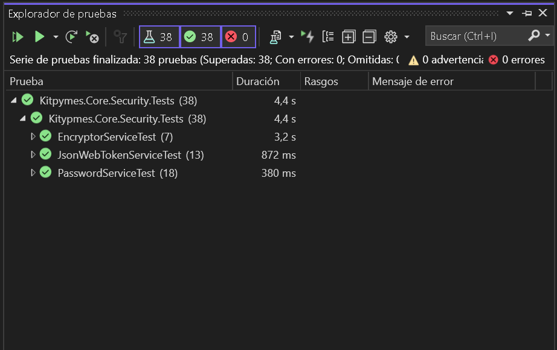

#  Kitpymes.Core.Security

**Security, Json Web Token, Password Service, Encrypt, Decrypt, Seguridad, Token de sesión, Servicio de contraseña, encriptador, desencriptador**

[](https://github.com/kitpymes/kitpymes-core-security/actions/workflows/ci.yml)
[](https://www.nuget.org/packages/Kitpymes.Core.Security/)
[](https://www.nuget.org/stats/packages/Kitpymes.Core.Security?groupby=Version)
[](https://github.com/kitpymes/kitpymes-core-security/blob/master/docs/LICENSE.txt)
[](https://github.com/kitpymes/kitpymes-core-security/)
[](https://github.com/kitpymes/kitpymes-core-security/)

## 📋 Requerimientos 

* Visual Studio 2026 o superior

* NET TargetFramework = net10.0

* SDK de .NET = 10.0.x

* C# = 12

* Conocimientos sobre Inyección de Dependencias

## 🔧 Instalación 

_Se puede instalar usando el administrador de paquetes Nuget o CLI dotnet._

_Nuget_

```
Install-Package Kitpymes.Core.Security
```

_CLI dotnet_

```
dotnet add package Kitpymes.Core.Security
```

## ⌨️ Código

```cs
public class SecuritySettings
{
    public EncryptorSettings EncryptorSettings { get; set; } = new EncryptorSettings();
    
    public JsonWebTokenSettings JsonWebTokenSettings { get; set; } = new JsonWebTokenSettings();

    public PasswordSettings PasswordSettings { get; set; } = new PasswordSettings();
}
```

```cs
public class SecurityOptions
{
    public SecurityOptions WithEncryptor(IConfiguration configuration) {}

    public SecurityOptions WithEncryptor(Action<EncryptorOptions> options) {}

    public SecurityOptions WithEncryptor(EncryptorSettings settings) {}

    
    public SecurityOptions WithJsonWebToken(IConfiguration configuration) {}
    
    public SecurityOptions WithJsonWebToken(Action<JsonWebTokenOptions> option) {}

    public SecurityOptions WithJsonWebToken(JsonWebTokenSettings settings) {}


    public SecurityOptions WithPassword(IConfiguration configuration) {}

    public SecurityOptions WithPassword(Action<PasswordOptions> option) {}

    public SecurityOptions WithPassword(PasswordSettings settings) {}
}
```

```cs
public static class SecurityServiceCollectionExtensions
{
    public static IServiceCollection LoadSecurity(this IServiceCollection services, IConfiguration configuration) {}

    public static IServiceCollection LoadSecurity(this IServiceCollection services, Action<SecurityOptions> options) {}

    public static IServiceCollection LoadSecurity(this IServiceCollection services, SecuritySettings settings) {}
}
```

### Encryptor

```cs
public class EncryptorSettings
{
    public bool? Enabled { get; set; }

    public string? ApplicationName { get; set; }

    public int? KeyLifetimeFromDays { get; set; }

    public string? PersistKeysToFileSystem { get; set; }
}
```

```cs
public class EncryptorOptions
{
    public EncryptorOptions WithEnabled(bool enabled = true) {}

    public EncryptorOptions WithApplicationName(string? applicationName) {}

    public EncryptorOptions WithKeyLifetimeFromDays(int? keyLifetimeFromDays) {}

    public EncryptorOptions WithPersistKeysToFileSystems(string? persistKeysToFileSystem) {}
}
```

```cs
public static class EncryptorServiceCollectionExtensions
{
    public static IEncryptorService GetEncryptor(this IServiceCollection services) {}

    public static IServiceCollection LoadEncryptor(this IServiceCollection services, Action<EncryptorOptions> settings) {}

    public static IServiceCollection LoadEncryptor(this IServiceCollection services, EncryptorSettings settings) {}

    public static IServiceCollection LoadEncryptor(this IServiceCollection services, Action<IDataProtectionBuilder> dataProtectionBuilder) {}
}
```

```cs
public interface IEncryptorService
{
    string Encrypt(string? value, TimeSpan? lifetime = null);

    string Decrypt(string? value);

    string Encrypt<T>(T value, TimeSpan? lifetime = null) where T : class;

    T Decrypt<T>(string? value) where T : class, new();
}
```

### JsonWebToken

```cs
public interface IJsonWebTokenService
{
    (string Token, string Expire) Encode(IList<Claim> claims, Dictionary<string, object>? headers = null);

    Dictionary<string, object> Decode(string? token);

    Task<(string Token, string Expire)> EncodeAsync(IList<Claim> claims, Dictionary<string, object>? headers = null);

    Task<Dictionary<string, object>> DecodeAsync(string? token);
}
```

```cs
public class ExpireSettings
{
    public int? Days { get; set; }

    public int? Hours { get; set; }

    public int? Minutes { get; set; }

    public int? Seconds { get; set; }
}
```

```cs
public class JsonWebTokenSettings
{
    [JsonIgnore]
    public TokenValidationParameters TokenValidationParameters => new TokenValidationParameters
    {
        ValidateIssuerSigningKey = !string.IsNullOrWhiteSpace(Key),
        IssuerSigningKey = new SymmetricSecurityKey(Encoding.UTF8.GetBytes(_key)),

        ValidateIssuer = !string.IsNullOrWhiteSpace(ValidIssuer),
        ValidIssuer = ValidIssuer,

        ValidateAudience = !string.IsNullOrWhiteSpace(ValidAudience),
        ValidAudience = ValidAudience,

        ValidateLifetime = !(LifetimeValidator is null),
        LifetimeValidator = LifetimeValidator,

        // Tiempo de caducidad del búfer, el tiempo efectivo total es igual al tiempo más el tiempo de caducidad de Jwt. Si no está configurado, el valor predeterminado es 5 minutos.
        ClockSkew = TimeSpan.FromSeconds(30),

        RequireExpirationTime = _requireExpirationTime,
    };

    [JsonIgnore]
    public LifetimeValidator LifetimeValidator { get; set; } = (before, expires, token, param) => expires > DateTime.UtcNow;

    public ExpireSettings Expire { get; set; } = new ExpireSettings();

    public bool? Enabled { get; set; }

    public string? ValidAudience { get; set; }

    public string? ValidIssuer { get; set; }

    public string? Key { get; set; }

    public string? AuthenticateScheme { get; set; }

    public string? ChallengeScheme { get; set; }

    public bool? RequireExpirationTime { get; set; }
}
```

```cs
public static class JsonWebTokenServiceCollectionExtensions
{
    public static IJsonWebTokenService GetJsonWebToken(this IServiceCollection services) {}

    public static IServiceCollection LoadJsonWebToken(this IServiceCollection services, Action<JsonWebTokenOptions>? options = null, bool enabled = true) {}

    public static IServiceCollection LoadJsonWebToken(this IServiceCollection services, JsonWebTokenSettings settings) {}
}
```

### Password

Hash de contraseñas con PBKDF2 (por defecto HMACSHA256 con 600.000 iteraciones, la cifra que recomienda OWASP) y una política de contraseñas configurable.

```cs
public interface IPasswordService
{
    // Contraseña al azar que cumple la política; null si no se puede (por ejemplo, más caracteres únicos que los disponibles).
    string? CreateRandom();

    // Comprueba la política y crea el hash. Si la contraseña no la cumple, hashPassword es null y errors dice por qué.
    (string? hashPassword, ReadOnlyCollection<PasswordErrorResult> errors) Create(string? plainPassword);

    // Compara con el hash. Lee algoritmo, iteraciones y sal del propio hash, y no aplica la política.
    bool Verify(string? plainPassword, string? hashPassword);

    // true si el hash se creó con parámetros distintos de la configuración actual: hay que regenerarlo.
    bool NeedsRehash(string? hashPassword) => false;

    ReadOnlyCollection<PasswordErrorResult> Validate(string? plainPassword);
}
```

Inicio de sesión, regenerando los hashes antiguos (por ejemplo, al subir `IterCount`):

```cs
if (passwordService.Verify(password, user.PasswordHash))
{
    if (passwordService.NeedsRehash(user.PasswordHash))
    {
        var (hash, _) = passwordService.Create(password);

        user.PasswordHash = hash!;
    }
}
```

Cada `Verify` calcula PBKDF2: limitar en la aplicación la frecuencia de intentos de inicio de sesión.

```cs
public enum PasswordErrorResult
{
    RequiredValue,

    RequireDigit,

    RequiredMinLength,

    RequiredUniqueChars,

    RequireEspecialChars,

    RequireLowercase,

    RequireUppercase,
}
```

```cs
public class PasswordSettings
{
    public bool? Enabled { get; set; }                 // false

    public bool? RequireDigit { get; set; }            // false

    public bool? RequireLowercase { get; set; }        // false

    public bool? RequireUppercase { get; set; }        // false

    public bool? RequireEspecialChars { get; set; }    // false

    public bool? RequiredUniqueChars { get; set; }     // false: sin caracteres repetidos

    public int? RequiredMinLength { get; set; }        // 6; un valor menor que 1 se ignora

    public EncryptionSettings EncryptionSettings { get; set; } = new EncryptionSettings();
}
```

```cs
public partial class EncryptionSettings
{
    public byte? FormatMarker { get; set; }            // 0xC0; no cambiarlo con hashes guardados

    public int? IterCount { get; set; }                // 600000; Create lanza por encima de 10.000.000

    public int? HeaderByteLength { get; set; }         // 13; no cambiarlo con hashes guardados

    public int? KeyDerivationAlgorithm { get; set; }   // 1 (0 = HMACSHA1, 1 = HMACSHA256, 2 = HMACSHA512)

    public int? SaltLength { get; set; }               // 16; Create lanza por encima de 1024
}
```

```cs
public class PasswordOptions
{
    public PasswordOptions WithEnabled(bool enabled = true) {}

    public PasswordOptions WithRequireDigit(bool requireDigit = true) {}

    public PasswordOptions WithRequireLowercase(bool requireLowercase = true) {}

    public PasswordOptions WithRequireUppercase(bool requireUppercase = true) {}

    public PasswordOptions WithRequireEspecialCharacters(bool requireEspecialChars = true) {}

    public PasswordOptions WithRequiredUniqueChars(bool requiredUniqueChars = true) {}

    public PasswordOptions WithRequiredMinLength(int requiredMinLength = 6) {}
}
```

```cs
services.LoadSecurity(security => security.WithPassword(password => password
    .WithEnabled()
    .WithRequireDigit()
    .WithRequiredMinLength(10)));

var passwordService = services.GetPassword();
```

## ⚙️ Pruebas Unitarias

_Cada proyecto tiene su respectivo test, se ejecutan desde el "Explorador de pruebas"_




## 🛠️ Construido con 

* [NET Core](https://dotnet.microsoft.com/download) - Framework de trabajo
* [C#](https://docs.microsoft.com/es-es/dotnet/csharp/) - Lenguaje de programación
* [Inserción de dependencias](https://docs.microsoft.com/es-es/aspnet/core/fundamentals/dependency-injection?view=aspnetcore-3.0) - Patrón de diseño de software
* [MSTest](https://docs.microsoft.com/es-es/dotnet/core/testing/unit-testing-with-mstest) - Pruebas unitarias
* [Nuget](https://www.nuget.org/) - Manejador de dependencias
* [Visual Studio](https://visualstudio.microsoft.com/) - Entorno de programacion


## ✒️ Autores 

* **Sebastian R Ferrari** - *Trabajo Inicial* - [kitpymes](https://kitpymes.com)


## 📄 Licencia 

* Este proyecto está bajo la Licencia [LICENSE](LICENSE.txt)


## 🎁 Gratitud 

* Este proyecto fue diseñado para compartir, creemos que es la mejor forma de ayudar 📢
* Cada persona que contribuya sera invitada a tomar una 🍺 
* Gracias a todos! 🤓

---
[Kitpymes](https://github.com/kitpymes) 😊